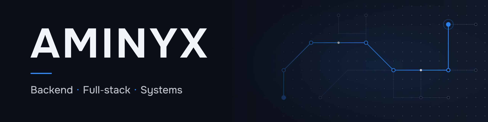
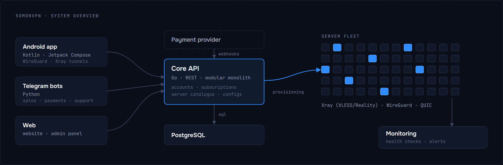

## Aminjon Azizov

**Backend & Full-stack Developer · Python, Go · AI-assisted development**

I design, build and run production systems: backend services, Telegram bots, an Android
client and the Linux server fleet behind them. AI coding agents (Claude Code, Codex) are my
main tools — I own the architecture and the task breakdown, review and test what the agents
write, debug in production and keep the service running.

[-111827?style=flat-square&logo=readthedocs&logoColor=2F8CFF)](https://aminyx.top/cv/aminjon-azizov-cv-ru.pdf)

Tajikistan · open to remote full-time roles · Russian and Tajik (fluent), English (basic)

### Commercial experience

**SomonVPN** — a commercial VPN service, built and operated end to end.
Closed source; case study on [aminyx.top](https://aminyx.top/#p-somonvpn).

- **Backend** — Go modular monolith, REST API, PostgreSQL: accounts, subscriptions, payments,
  server catalogue, client config generation
- **Bots** — Telegram bots in Python for sales, payments and support
- **Android** — Kotlin / Jetpack Compose client with WireGuard and Xray tunnels
- **Infrastructure** — Linux server fleet (Xray VLESS/Reality, WireGuard, QUIC) with automated
  provisioning, health checks and monitoring
- **Aminyx Link** — an experimental transport protocol in Rust used inside the product;
  closed source, not independently audited

**Client project** — a turnkey VPN service for a client: website, user dashboard, Telegram bot
with payments, and the servers.

### Selected projects

| Project | What it is | Stack |
|---|---|---|
| [**aminyx.top**](https://github.com/aminyx/aminyx.top) | Personal site and portfolio: three languages, three.js scenes on a single WebGL context, Playwright smoke tests in CI | JavaScript · Vite · three.js |
| [**somoni-tracker**](https://github.com/aminyx/somoni-tracker) | Expense tracker: Telegram bot for one-line input in RU/TJ/EN with typo-tolerant categories, plus a web analytics dashboard | TypeScript · Next.js · grammY · Drizzle · SQLite · Docker |
| [**Cybersec**](https://github.com/aminyx/Cybersec) | Free cybersecurity course from zero to junior in Russian and Tajik, with a quiz site and CTF tasks — [site](https://aminyx.github.io/Cybersec/) | Python · GitHub Pages |
| [**keelstore**](https://github.com/aminyx/keelstore) | *Experimental — a learning project built with an AI agent.* Embedded LSM-tree key-value store: WAL, skiplist, bloom filter, levelled compaction | Go |
| [**hnsw**](https://github.com/aminyx/hnsw) | *Experimental — a learning project built with an AI agent.* HNSW vector-search index with an in-browser demo — [demo](https://aminyx.github.io/hnsw/) | Rust |

### Stack

### How I work

- **Architecture first.** I decide the structure, data model and boundaries, then split the
  work into small, checkable tasks for AI agents.
- **Verification, not trust.** Every change goes through tests, a second agent as reviewer,
  and checks on real devices and servers before it ships.
- **I run what I ship.** Logs, monitoring, incident response and production fixes are part
  of the job.
